# Lineage

Every released JAR, its SHA-256, and its parent. Two kinds of parent are shown because they are not always the same thing:

* **declared base** - the base the build audit, checkpoint or build script of that version states (`basis` says which).
* **nearest by content** - the earlier JAR whose ZIP entries (name + CRC-32) are closest, computed mechanically.

Where the two differ it is called out in the table and in *Discrepancies* below. Hashes are SHA-256 of the exact JAR file in `releases/`. `data/lineage.json` carries the same information in machine-readable form plus the per-entry diff lists.

| # | Version (tag) | Date (UTC-3) | Kind | Size B | Entries | Declared base (basis) | Nearest by content | Entries identical / changed / added / removed vs nearest | SHA-256 |
|--:|---|---|---|--:|--:|---|---|---|---|
| 1 | `beta.3` | 2026-09-08 03:28 | base | 197009 | 98 | - | - | - | `d39feb760fd74b3fd596b50832fd85f80d0d056ec47f33bfa48a244415bd7fb0` |
| 2 | `beta.4` | 2026-09-08 04:12 | side-branch | 216004 | 112 | beta.3 (checkpoint) | beta.3 | 94 / 4 / 14 / 0 | `38a41936cd3a82dca08c351ae3b4901f13900b2a71a5c1e17c0be66bd0b1ee2c` |
| 3 | `beta.7` | 2026-09-14 22:15 | mainline | 220825 | 107 | beta.3 (content-nearest) | beta.3 | 92 / 6 / 9 / 0 | `6b0f6a4dd0cb4a7d06eadcc7211be44aa99bda5e31e3b5720e34a1aaafc4517d` |
| 4 | `beta.8` | 2026-09-22 14:05 | mainline | 224019 | 108 | beta.7 (content-nearest) | beta.7 | 100 / 7 / 1 / 0 | `010c3b9f4fdd20528a772904f13238aa836c8af13759aebfe7184ed07beed44b` |
| 5 | `beta.9` | 2026-09-23 16:40 | experiment | 233341 | 113 | beta.8 (checkpoint) | beta.8 | 104 / 4 / 5 / 0 | `695d6bd9681070bba8bc8e80bc9bc89d9ac02b2b524725dcbc30dc024e116740` |
| 6 | `beta.9-MPS-Angelica` | 2026-09-23 16:42 | experiment | 233345 | 113 | beta.8 (checkpoint) | beta.8 | 104 / 4 / 5 / 0 | `cefc4f7b13e9c9bdba5f3c2c3c4a534d75a7d22096c6ea012737ef671e885e70` |
| 7 | `beta.10-Cinematic-Angelica` | 2026-09-23 17:49 | experiment | 232088 | 111 | beta.8 (checkpoint) | beta.8 | 104 / 4 / 3 / 0 | `3182e7e3d6b51854eae008ff8eb8f346a1d0a8b291740ceff8dab9c5fabc9dab` |
| 8 | `beta.11-Async-Forestry` | 2026-09-24 03:03 | mainline | 234571 | 114 | beta.8 (checkpoint) | beta.8 | 104 / 4 / 6 / 0 | `1fb3947f88442e4f9ebe6bdc8526e7ed288d31bbfa7f0f04ad8da220fa3a152d` |
| 9 | `beta.12-AtlasProfiler` | 2026-09-24 03:53 | mainline | 236711 | 114 | beta.11-Async-Forestry (build-audit) | beta.11-Async-Forestry | 109 / 5 / 0 / 0 | `ec498ac793af3dfc755a71b71b15b7bb85fae742b5727d1085c41975d5e274ed` |
| 10 | `beta.13-StitchCache` | 2026-09-24 04:22 | mainline | 250914 | 118 | beta.12-AtlasProfiler (checkpoint) | beta.12-AtlasProfiler | 109 / 5 / 4 / 0 | `4ea949e6962e09cee40cedb2da0bdc862e58e3cd77fede3e09334fedf95a570d` |
| 11 | `beta.14-UploadProfiler` | 2026-09-24 13:14 | mainline | 255862 | 120 | beta.13-StitchCache (checkpoint) | beta.13-StitchCache | 112 / 6 / 2 / 0 | `bb352119296eddd4e6e74c8d46a05cb209fedaefdb8f755c120ee8422a0f0ddc` |
| 12 | `beta.15-MipmapProbe` | 2026-09-24 13:40 | mainline | 257162 | 121 | beta.14-UploadProfiler (checkpoint) | beta.14-UploadProfiler | 115 / 5 / 1 / 0 | `1e7008edf76156c07f19be7151554d87c677b675db723a7c61c89e3d5f09bd0d` |
| 13 | `beta.16-UniversalForestryC2` | 2026-09-24 14:47 | rejected-approach | 261009 | 123 | beta.15-MipmapProbe (content-nearest) | beta.15-MipmapProbe | 116 / 5 / 2 / 0 | `8ec2e72b2fb9488ac759e24705c22a1a05181afb107b861ca67a4c8139a4a483` |
| 14 | `beta.16-ForestryUniversal` | 2026-09-24 15:03 | alternate (same content as beta.17) | 262795 | 123 | beta.15-MipmapProbe (build-audit) | beta.15-MipmapProbe | 116 / 5 / 2 / 0 | `3e0bb92a0e7f78f01a15a555c80e5640d64a6145252eb06078d778821e2afffa` |
| 15 | `beta.17-ForestryUniversalTransformer` | 2026-09-24 15:34 | mainline | 262793 | 123 | beta.15-MipmapProbe (build-audit) | beta.16-ForestryUniversal **!=** | 120 / 3 / 0 / 0 | `18177c88421d675da07ab6dc7ed2b5d1437691d95b1b88eeec4c684814238cc7` |
| 16 | `beta.18-ItemsAtlasBatch` | 2026-09-24 16:06 | mainline | 270312 | 126 | beta.17-ForestryUniversalTransformer (build-audit) | beta.17-ForestryUniversalTransformer | 118 / 5 / 3 / 0 | `12f00211e9f8cd66cad9d9a90da7f809d4e1987a72d31461dfbe42edf5169262` |
| 17 | `beta.19-ItemsAtlasBatchPackFix` | 2026-09-24 16:23 | mainline | 271063 | 127 | beta.18-ItemsAtlasBatch (build-audit) | beta.18-ItemsAtlasBatch | 123 / 3 / 1 / 0 | `c3d2ef2127080898b0a5b0f54305056ee7deb1b8bbb8f50e9b9cf726aab08472` |
| 18 | `beta.20-StartupLifecycleProfiler` | 2026-09-24 17:07 | mainline | 280369 | 134 | beta.19-ItemsAtlasBatchPackFix (checkpoint) | beta.19-ItemsAtlasBatchPackFix | 122 / 5 / 7 / 0 | `00a29e58ebb428e915d3579ba3f6b9bceb6464d29d4f8c08ef7fe20285e3a48a` |
| 19 | `beta.21-WorldRenderStateRepair` | 2026-09-24 18:14 | mainline | 279861 | 129 | beta.20-StartupLifecycleProfiler (checkpoint) | beta.20-StartupLifecycleProfiler | 123 / 4 / 2 / 7 | `79dcb3f15653dc764c7075a06eafd0fb494261c8db35d3af3b5a2d830e1720f7` |
| 20 | `beta.22-WorldRenderStateProbeFix` | 2026-09-24 18:38 | mainline | 279865 | 129 | beta.21-WorldRenderStateRepair (build-audit) | beta.21-WorldRenderStateRepair | 125 / 4 / 0 / 0 | `1843eec1e4c0a98b67fcbf74d98f55cef8a51ac33eadff95c07b3010d72f1fff` |
| 21 | `beta.23-VertexCompatIsolation` | 2026-09-24 19:11 | mainline | 272076 | 127 | beta.22-WorldRenderStateProbeFix (build-audit) | beta.22-WorldRenderStateProbeFix | 123 / 4 / 0 / 2 | `5a3c563b61f26a24d84b3b4fe89e626afa82e87f35e1ccd51bd9e39acd6097c3` |
| 22 | `beta.24-TerrainStagingFallback` | 2026-09-24 20:12 | sibling-probe | 273707 | 128 | beta.23-VertexCompatIsolation (checkpoint) | beta.23-VertexCompatIsolation | 123 / 4 / 1 / 0 | `41c66f3567a66544118e71ed0ab60343fa352c56b89836f8668af959376f5922` |
| 23 | `beta.25-TerrainSemanticProbe` | 2026-09-24 22:52 | sibling-probe | 277172 | 129 | beta.23-VertexCompatIsolation (build-audit) | beta.23-VertexCompatIsolation | 123 / 4 / 2 / 0 | `1c06d807ea25832ec0dcb9a42a79feace4d1ce341702576a60562fc8010b05a1` |
| 24 | `beta.25-TerrainBlendAlphaProbe` | 2026-09-24 23:35 | mainline | 279857 | 131 | beta.23-VertexCompatIsolation (build-audit) | beta.23-VertexCompatIsolation | 123 / 4 / 4 / 0 | `f49b424c4000eb992a42cc9baff66c353d2c86bc28b21d10b19bed83b70766de` |
| 25 | `beta.26-DrawSubmissionProbe` | 2026-09-25 00:15 | mainline | 283752 | 132 | beta.25-TerrainBlendAlphaProbe (build-audit) | beta.25-TerrainBlendAlphaProbe | 127 / 4 / 1 / 0 | `8b5b24170ddcf4ad4d1ef88de91e6ef558b2e241146bf02b3f5d91ffc3fcbe0e` |
| 26 | `beta.27-ProxyVanillaChunkTrackingCompat` | 2026-09-25 01:04 | mainline | 287216 | 134 | beta.26-DrawSubmissionProbe (build-audit) | beta.26-DrawSubmissionProbe | 128 / 4 / 2 / 0 | `fd0a88afa9ec037f326be8cc5d702f865d6ded70f80b2c7f3002d330ce43140c` |
| 27 | `beta.28-REJECTED-direct-numina-mixin` | 2026-09-25 02:08 | REJECTED | 290377 | 136 | beta.27-ProxyVanillaChunkTrackingCompat (content-nearest) | beta.27-ProxyVanillaChunkTrackingCompat | 130 / 4 / 2 / 0 | `720a14f28df074c5c8ab517a0a0dad8e77390318736f5709212d7e9f1293efe6` |
| 28 | `beta.28-REJECTED-stale-b317103` | 2026-09-25 02:19 | REJECTED | 290015 | 136 | beta.27-ProxyVanillaChunkTrackingCompat (content-nearest) | beta.27-ProxyVanillaChunkTrackingCompat | 130 / 4 / 2 / 0 | `b317103891f28d5b1e5e9b37447b0acb682d3083da5498302ac17fe18636355b` |
| 29 | `beta.28-NuminaFovFiniteGuard` | 2026-09-25 02:30 | mainline | 289778 | 136 | beta.27-ProxyVanillaChunkTrackingCompat (build-audit) | beta.27-ProxyVanillaChunkTrackingCompat | 130 / 4 / 2 / 0 | `c84d21a316879b8afe9a50e928caef7788acf769c3d75926cdff1a21fd038443` |
| 30 | `beta.29-StartupAudit` | 2026-09-25 13:30 | diagnostic-side-branch | 311047 | 152 | beta.28-NuminaFovFiniteGuard (checkpoint) | beta.28-NuminaFovFiniteGuard | 132 / 4 / 16 / 0 | `45cc1b2d1a8f80e0cc2416050477f17d96a151568fffec73090aeab69b029317` |
| 31 | `beta.30-BlockAtlasUploadBatcher` | 2026-09-25 15:18 | superseded-iteration | 300712 | 141 | beta.28-NuminaFovFiniteGuard (checkpoint) | beta.28-NuminaFovFiniteGuard | 131 / 5 / 5 / 0 | `75499a492a62cc9540f64cf7a30e86abad5310e877a741e5049772d89c089ef6` |
| 32 | `beta.30.1-BlockAtlasShadowFix` | 2026-09-25 15:59 | superseded-iteration | 300721 | 141 | beta.28-NuminaFovFiniteGuard (build-audit) | beta.30-BlockAtlasUploadBatcher **!=** | 137 / 4 / 0 / 0 | `c906c6dfe9b6c38018eaec0870d6b76878b852f64fe35350f1725a8aa4f0ca77` |
| 33 | `beta.30.2-BlockAtlasReobfFix` | 2026-09-25 16:23 | mainline | 300660 | 141 | beta.28-NuminaFovFiniteGuard (build-audit) | beta.30.1-BlockAtlasShadowFix **!=** | 131 / 10 / 0 / 0 | `a47b80478d5e64736fd624c75569cab00a2dbc11270bef0f24e89e624b5a705b` |
| 34 | `beta.31-FMLPhaseAudit` | 2026-09-25 16:53 | mainline | 318703 | 155 | beta.30.2-BlockAtlasReobfFix (checkpoint) | beta.30.2-BlockAtlasReobfFix | 137 / 4 / 14 / 0 | `45a2c442e9173e33364084b6c73bdd570d570c330a609d6b812ade4d83ee1228` |
| 35 | `beta.32-HotspotAudit` | 2026-09-25 19:43 | mainline | 324850 | 157 | beta.31-FMLPhaseAudit (checkpoint) | beta.31-FMLPhaseAudit | 151 / 4 / 2 / 0 | `ee26b8b61c1c93e7611a7ad898989356cb9e38bf03c68be09882559a1b107f30` |
| 36 | `beta.33-WindowLifecycleFix` | 2026-09-25 20:04 | mainline | 329876 | 159 | beta.32-HotspotAudit (checkpoint) | beta.32-HotspotAudit | 153 / 4 / 2 / 0 | `6957c792cc4555c0de6eecf63d375799942269f976bfca1a2d396f116f31921d` |
| 37 | `beta.34-ItemIconMainThread` | 2026-09-25 20:35 | mainline | 330139 | 159 | beta.33-WindowLifecycleFix (build-script) | beta.33-WindowLifecycleFix | 155 / 4 / 0 / 0 | `fd13dea51ad36b04c2357083b136f1174b4882c572f86c0492875e9b356570a8` |
| 38 | `beta.35-BackhandLifecycleFix` | 2026-09-25 23:54 | mainline | 330348 | 159 | beta.34-ItemIconMainThread (verified-diff) | beta.34-ItemIconMainThread | 156 / 3 / 0 / 0 | `c48d3ec3b1ef35f907baca47cd78ead48730b4cd556592e529c0140d7a869c17` |
| 39 | `beta.36-ForestryC2CompileBarrier` | 2026-10-24 | mainline | 332666 | 159 | beta.35-BackhandLifecycleFix (build-audit) | beta.35-BackhandLifecycleFix | 154 / 5 / 0 / 0 | `45a00f1ea27778d9d01d392180c1a3980e440370beeb84ec0af9213e836e2bf4` |
| 40 | `beta.37-ForestryGenomeBarrier` | 2026-10-24 | mainline | 329030 | 158 | beta.36-ForestryC2CompileBarrier (build-audit) | beta.36-ForestryC2CompileBarrier | 153 / 5 / 0 / 1 | `2209938684e5ae9f0f86946a2ae3612fcf2bb9528d590fd29e268eb47a3e483c` |
| 41 | `beta.38-AngelicaFontCompat` | 2026-10-25 | mainline (do not install: fix inert under Mixingasm) | 335934 | 160 | beta.37-ForestryGenomeBarrier (build-audit) | beta.37-ForestryGenomeBarrier | 153 / 5 / 2 / 0 | `bef913778167a2fb540b638bf8276981073eb39b014b30ca07df1d94bf2ff701` |
| 42 | `beta.39-AngelicaFontMixinTrust` | 2026-10-25 | mainline | 335978 | 160 | beta.38-AngelicaFontCompat (build-audit) | beta.38-AngelicaFontCompat | 156 / 4 / 0 / 0 | `8054509c0dc5067e2e043b34f6b93480e29aca285eabb1fcb3d7d8ac9ca73cbd` |
| 43 | `beta.40-ItemsAtlasAngelicaGuard` | 2026-10-25 | mainline | 337237 | 161 | beta.39-AngelicaFontMixinTrust (build-audit) | beta.39-AngelicaFontMixinTrust | 156 / 4 / 1 / 0 | `242f07422c1a8013ca72755b8cc3765636a2cc1a3f04b98075475707b78676f2` |
| 44 | `beta.41-RenderCrashRecovery` | 2026-10-26 | mainline | 348552 | 165 | beta.40-ItemsAtlasAngelicaGuard (build-audit) | beta.40-ItemsAtlasAngelicaGuard | 157 / 4 / 4 / 0 | `8d7fddf3f2b00d3d97e5480dc3538e53a9b969fda745b99ec17edce7f52a4f6e` |
| 45 | `beta.42-MiraiShaderBridge` | 2026-10-26 | mainline | 364197 | 173 | beta.41-RenderCrashRecovery (build-audit) | beta.41-RenderCrashRecovery | 161 / 4 / 8 / 0 | `245e67cbf8f82e4395a9706c21bbee2ebd94911774600aa1e06f188adc0415df` |
| 46 | `beta.43-HologramFastPath` | 2026-10-26 | mainline | 376566 | 177 | beta.42-MiraiShaderBridge (build-audit) | beta.42-MiraiShaderBridge | 169 / 4 / 4 / 0 | `38f97b919e59011c9ee4fdf0829e958c3b5a3828e68aa25177dbad5b685da59a` |
| 47 | `beta.44-Angelica240Decoration` | 2026-10-29 | mainline | 376644 | 177 | beta.43-HologramFastPath (build-audit) | beta.43-HologramFastPath | 173 / 4 / 0 / 0 | `de1822940a65eef3a83297822a0fca143562dcda1afedae84cc2ce13d1064027` |
| 48 | `beta.45-AgriCraftIrrigationGuard` | 2026-10-29 | mainline | 380277 | 179 | beta.44-Angelica240Decoration (build-audit) | beta.44-Angelica240Decoration | 173 / 4 / 2 / 0 | `d2b5e3076881cba1c8f5d1179c75b126574a16c269dce17768bc5104a93fe035` |

## Mainline (ancestors of the current version)

Following *declared base* backwards from beta.45 gives the line that is actually inherited by the build in use today:

`beta.3` -> `beta.7` -> `beta.8` -> `beta.11-Async-Forestry` -> `beta.12-AtlasProfiler` -> `beta.13-StitchCache` -> `beta.14-UploadProfiler` -> `beta.15-MipmapProbe` -> `beta.17-ForestryUniversalTransformer` -> `beta.18-ItemsAtlasBatch` -> `beta.19-ItemsAtlasBatchPackFix` -> `beta.20-StartupLifecycleProfiler` -> `beta.21-WorldRenderStateRepair` -> `beta.22-WorldRenderStateProbeFix` -> `beta.23-VertexCompatIsolation` -> `beta.25-TerrainBlendAlphaProbe` -> `beta.26-DrawSubmissionProbe` -> `beta.27-ProxyVanillaChunkTrackingCompat` -> `beta.28-NuminaFovFiniteGuard` -> `beta.30.2-BlockAtlasReobfFix` -> `beta.31-FMLPhaseAudit` -> `beta.32-HotspotAudit` -> `beta.33-WindowLifecycleFix` -> `beta.34-ItemIconMainThread` -> `beta.35-BackhandLifecycleFix` -> `beta.36-ForestryC2CompileBarrier` -> `beta.37-ForestryGenomeBarrier` -> `beta.38-AngelicaFontCompat` -> `beta.39-AngelicaFontMixinTrust` -> `beta.40-ItemsAtlasAngelicaGuard` -> `beta.41-RenderCrashRecovery` -> `beta.42-MiraiShaderBridge` -> `beta.43-HologramFastPath` -> `beta.44-Angelica240Decoration` -> `beta.45-AgriCraftIrrigationGuard`

Composition check (beta.43's build audit, `lineage_composition`): every entry that beta.38, 39, 40, 41, 42 and 43 added or changed is in the beta.43 JAR as its newest version, so the line is one JAR, not a set of separate ones. Since beta.42 the Et Futurum elytra fix (`projects/Akashic-ChromaPlayerApiPreloadFix`, a separate coremod JAR on 2026-10-26) is part of it too.

Everything else is a side branch, an experiment, a sibling probe or a rejected build (see the *Kind* column).

## Graph

```mermaid
graph LR
  nd39feb76["beta.3"]
  n38a41936["beta.4"]
  n6b0f6a4d["beta.7"]
  n010c3b9f["beta.8"]
  n695d6bd9["beta.9"]
  ncefc4f7b["beta.9-MPS-Angelica"]
  n3182e7e3["beta.10-Cinematic-Angelica"]
  n1fb3947f["beta.11-Async-Forestry"]
  nec498ac7["beta.12-AtlasProfiler"]
  n4ea949e6["beta.13-StitchCache"]
  nbb352119["beta.14-UploadProfiler"]
  n1e7008ed["beta.15-MipmapProbe"]
  n8ec2e72b["beta.16-UniversalForestryC2"]
  n3e0bb92a["beta.16-ForestryUniversal"]
  n18177c88["beta.17-ForestryUniversalTransformer"]
  n12f00211["beta.18-ItemsAtlasBatch"]
  nc3d2ef21["beta.19-ItemsAtlasBatchPackFix"]
  n00a29e58["beta.20-StartupLifecycleProfiler"]
  n79dcb3f1["beta.21-WorldRenderStateRepair"]
  n1843eec1["beta.22-WorldRenderStateProbeFix"]
  n5a3c563b["beta.23-VertexCompatIsolation"]
  n41c66f35["beta.24-TerrainStagingFallback"]
  n1c06d807["beta.25-TerrainSemanticProbe"]
  nf49b424c["beta.25-TerrainBlendAlphaProbe"]
  n8b5b2417["beta.26-DrawSubmissionProbe"]
  nfd0a88af["beta.27-ProxyVanillaChunkTrackingCompat"]
  n720a14f2["beta.28-REJECTED-direct-numina-mixin"]
  nb3171038["beta.28-REJECTED-stale-b317103"]
  nc84d21a3["beta.28-NuminaFovFiniteGuard"]
  n45cc1b2d["beta.29-StartupAudit"]
  n75499a49["beta.30-BlockAtlasUploadBatcher"]
  nc906c6df["beta.30.1-BlockAtlasShadowFix"]
  na47b8047["beta.30.2-BlockAtlasReobfFix"]
  n45a2c442["beta.31-FMLPhaseAudit"]
  nee26b8b6["beta.32-HotspotAudit"]
  n6957c792["beta.33-WindowLifecycleFix"]
  nfd13dea5["beta.34-ItemIconMainThread"]
  nc48d3ec3["beta.35-BackhandLifecycleFix"]
  nd39feb76 --> n38a41936
  nd39feb76 --> n6b0f6a4d
  n6b0f6a4d --> n010c3b9f
  n010c3b9f --> n695d6bd9
  n010c3b9f --> ncefc4f7b
  n010c3b9f --> n3182e7e3
  n010c3b9f --> n1fb3947f
  n1fb3947f --> nec498ac7
  nec498ac7 --> n4ea949e6
  n4ea949e6 --> nbb352119
  nbb352119 --> n1e7008ed
  n1e7008ed --> n8ec2e72b
  n1e7008ed --> n3e0bb92a
  n1e7008ed --> n18177c88
  n18177c88 --> n12f00211
  n12f00211 --> nc3d2ef21
  nc3d2ef21 --> n00a29e58
  n00a29e58 --> n79dcb3f1
  n79dcb3f1 --> n1843eec1
  n1843eec1 --> n5a3c563b
  n5a3c563b --> n41c66f35
  n5a3c563b --> n1c06d807
  n5a3c563b --> nf49b424c
  nf49b424c --> n8b5b2417
  n8b5b2417 --> nfd0a88af
  nfd0a88af --> n720a14f2
  nfd0a88af --> nb3171038
  nfd0a88af --> nc84d21a3
  nc84d21a3 --> n45cc1b2d
  nc84d21a3 --> n75499a49
  nc84d21a3 --> nc906c6df
  nc84d21a3 --> na47b8047
  na47b8047 --> n45a2c442
  n45a2c442 --> nee26b8b6
  nee26b8b6 --> n6957c792
  n6957c792 --> nfd13dea5
  nfd13dea5 --> nc48d3ec3
  classDef main fill:#d4edda,stroke:#2e7d32;
  classDef rej fill:#f8d7da,stroke:#b71c1c;
  classDef side fill:#fff3cd,stroke:#8a6d3b;
  class nd39feb76,n6b0f6a4d,n010c3b9f,n1fb3947f,nec498ac7,n4ea949e6,nbb352119,n1e7008ed,n18177c88,n12f00211,nc3d2ef21,n00a29e58,n79dcb3f1,n1843eec1,n5a3c563b,nf49b424c,n8b5b2417,nfd0a88af,nc84d21a3,na47b8047,n45a2c442,nee26b8b6,n6957c792,nfd13dea5,nc48d3ec3 main;
  class n720a14f2,nb3171038 rej;
  class n38a41936,n695d6bd9,ncefc4f7b,n3182e7e3,n8ec2e72b,n3e0bb92a,n41c66f35,n1c06d807,n45cc1b2d,n75499a49,nc906c6df side;
```

## Discrepancies and how they were resolved

1. **beta.4 is a side branch.** It was built on beta.3 (`DeferredLinks` DimDoors approach). beta.7 is *also* built on beta.3 and contains none of the beta.4-only classes; it implements DimDoors client sync differently (`DimDoorsClientSync*`). So beta.7 does **not** descend from beta.4.
2. **beta.5 and beta.6 do not exist anywhere on disk.** Nothing in the searched folders (Codex, AkashicDev, Technic mods, rollback copies, QA instances) matches them. The numbering gap is real; their content is unknown.
3. **beta.7 and beta.8 are binary-only** (found in QA/rollback copies). Their parents are inferred by content only.
4. **beta.9 exists as two different builds** (`695d6bd9...` and `cefc4f7b...`). They differ in a single class. `cefc4f7b` is named *FINAL-CANDIDATE* in its checkpoint. The earlier one is kept as `v1.1.0-beta.9`; the later as `v1.1.0-beta.9-MPS-Angelica`.
5. **beta.11 descends from beta.8, not from beta.9/beta.10.** The checkpoint says so explicitly ("beta.9 ... NOT inherited. beta.10 ... NOT inherited"), and the hashes confirm it.
6. **beta.16 has two siblings.** `UniversalForestryC2` (Mixin `@Overwrite` shim) and `ForestryUniversal` (LaunchWrapper transformer). beta.17 is the transformer variant re-versioned: it differs from `ForestryUniversal` in only 3 entries (MANIFEST, mcmod.info, mod class). beta.17's audit declares **beta.15** as its base, so `ForestryUniversal` is a content-twin, not an ancestor. The Mixin variant was dropped later (beta.20 gate: "rejected MixinForestryGenomeC2 absent").
7. **beta.24 and beta.25-TerrainSemanticProbe are siblings, not ancestors.** Both are built on beta.23. beta.25-TerrainBlendAlphaProbe is also built on beta.23 and is the one beta.26 inherits.
8. **beta.29 is a diagnostic side branch.** Built on beta.28; beta.30 is *also* built on beta.28 and does not carry the beta.29 diagnostics.
9. **beta.30 / 30.1 / 30.2** all declare beta.28 as their base in their audits, but each is the "nearest by content" of the previous one. They are re-builds of the same feature with fixes (see CHANGELOG).
10. **Two beta.28 builds were rejected** and are kept only as evidence: `REJECTED-beta28-direct-numina-mixin.jar` (`720a14f2...`) and `REJECTED-beta28-stale-b317103.jar` (`b3171038...`). Do not install. The accepted beta.28 is `c84d21a3...`.
11. **Stale file names.** Several `base-*.jar` / `rollback-*.jar` copies on disk are named after one version but hold another. Identification in this repo is **by SHA-256 only**; names are never trusted.
12. **beta.35 JAR was found late** in the Technic `mods` folder; before that only its recovered/decompiled class existed. Its SHA-256 matches the one recorded by the recovery report, and the 3-entry diff against beta.34 matches the report exactly.
